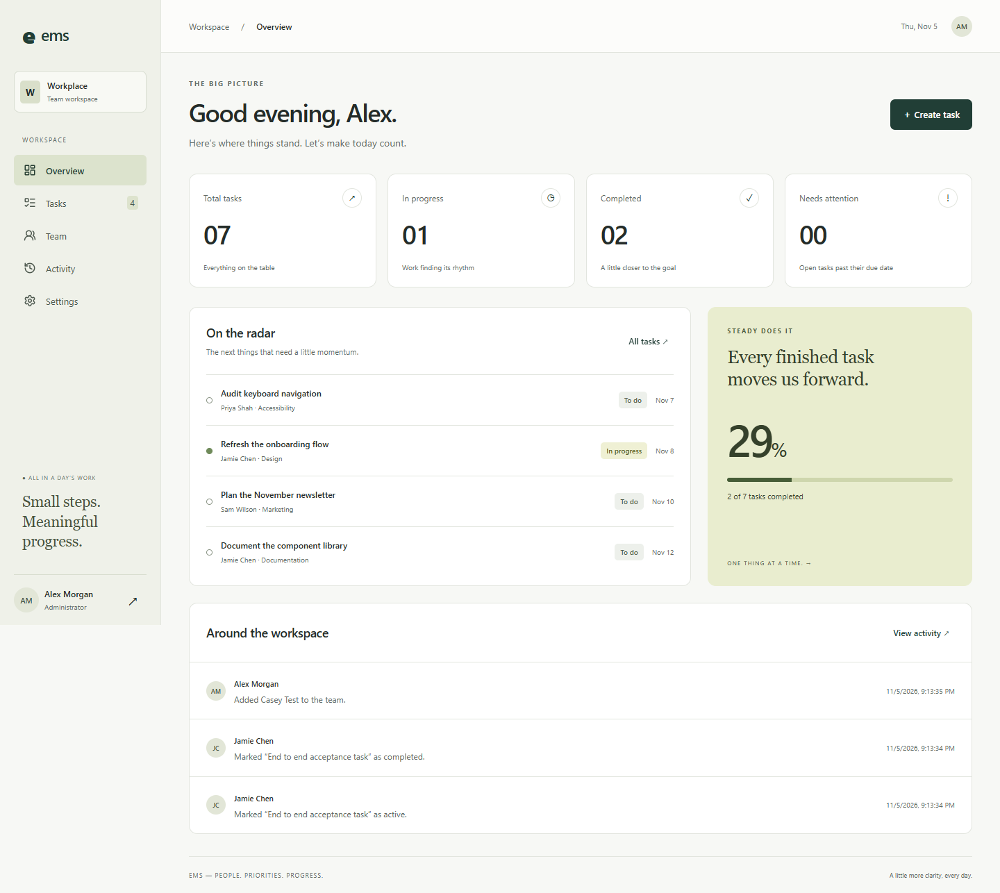

# EMS — People. Priorities. Progress.

A full-stack employee task workspace with separate administrator and employee experiences. Built as a portfolio project with real persistence, server-enforced permissions and browser-tested workflows.



## What it does

- Administrator: add employees, deactivate/reactivate access, create/edit/reassign/delete tasks, reopen tasks, inspect team workload and recent activity.
- Employee: see only assigned work, accept tasks, complete them or mark them blocked.
- Both: overview metrics, searchable task list, status filters, board view, CSV export, password changes and session logout.
- Responsive interface, keyboard-operable dialogs, reduced motion support and accessible form labels.

## Run locally

Requires **Node.js 22.15+** and npm. Node 22's built-in SQLite API currently emits an experimental warning; no separate database installation is needed.

```powershell
npm ci
Copy-Item .env.example .env
```

Edit `.env` and set `DEMO_PASSWORD` to your own password of at least 10 characters. Then:

```powershell
npm run dev
```

Open the URL printed by Vite (normally http://localhost:5173). The backend runs on port 3001; Vite forwards `/api` requests to it. Use the Vite URL for development so requests stay on the same origin.

### Seeded accounts

| Role                 | Email           |
| -------------------- | --------------- |
| Administrator        | admin@ems.local |
| Design employee      | jamie@ems.local |
| Engineering employee | priya@ems.local |
| Marketing employee   | sam@ems.local   |

All initial accounts use the password **you configured in `.env`**. These are fictional demo identities. Employees can change their passwords in Settings. The seed runs only on an empty database; changing `DEMO_PASSWORD` later does not reset existing passwords. After the first successful start, set `SEED_DEMO=false`.

Data is stored in `data/ems.sqlite`, excluded from Git. Browser reloads, logouts and server restarts retain it. Never commit `.env` or database files.

## Checks

```powershell
npm test
npm run lint
npm run build
npm run format:check
npm run test:e2e
npm audit
```

Browser tests use installed Microsoft Edge by default. On another platform, change `channel: 'msedge'` in `playwright.config.js` to your installed browser or omit it and run `npx playwright install chromium`. Tests use an isolated, in-memory database and fictional test-only credentials from `.env.test`. They never modify your local workspace database. Build before running browser tests.

## Architecture

```text
Browser (React) → /api (Node HTTP) → SQLite
                       ↓
                session + role checks
```

- `src/App.jsx`: workspace state, navigation and screens.
- `src/ui/`: shared field/dialog components and the sign-in screen.
- `src/api.js`: request handling and recoverable network errors.
- `src/index.css`: responsive design system and component states.
- `server/app.js`: HTTP endpoints, authentication, authorization and input validation.
- `server/store.js`: SQLite schema, password hashing and optional sample data.
- `server/index.js`: environment configuration and server lifecycle.
- `server/app.test.js`: API integration tests, running against real SQLite.
- `tests/`: browser acceptance, responsive and accessibility tests.
- `docs/`: architecture decisions, API reference, deployment and design review.

The original tutorial components under `src/components`, `src/context`, `src/utils`, plus `src/App.css`, remain as historical reference. They are not imported by the running application and are excluded from formatting/linting. The live app uses the modules listed above.

### Deliberate choices

SQLite keeps a recruiter’s local setup small and makes the demo inexpensive to host as one process. SQL uses bound parameters; foreign keys and status checks protect integrity. A larger multi-instance service would need a shared database, migrations, distributed rate limiting and an explicit organization model.

The backend uses Node's HTTP module rather than Express to keep runtime dependencies minimal. Sessions live in the database, passwords use salted scrypt hashes, and cookies are HttpOnly and SameSite=Strict. Secure cookies are enabled in production, which requires HTTPS. State-changing endpoints require a same-origin request header, and login attempts are rate limited per direct client IP. The UI is never the authorization boundary.

## Production build

```powershell
npm run build
npm start
```

Open http://127.0.0.1:3001 for a local production-build preview. For public hosting, follow [deployment instructions](docs/DEPLOYMENT.md): HTTPS, a persistent volume, secrets supplied by the host, and backups are required. A Dockerfile is included. No cloud resources are provisioned and no paid services are required for local use.

## Interview walkthrough

1. Sign in as admin, create an employee and assign a task.
2. Sign out and sign in as that employee: only their tasks are returned by the server.
3. Accept the task, then complete it. Reload to demonstrate persistence.
4. Sign back in as admin to see the progress metric and activity update.
5. Discuss session revocation, SQL parameter binding, task state transitions and the SQLite scaling tradeoff.

This application manages employee task assignments, not payroll, attendance or HR records. Public signup and email-based password recovery are outside this demo’s scope.
